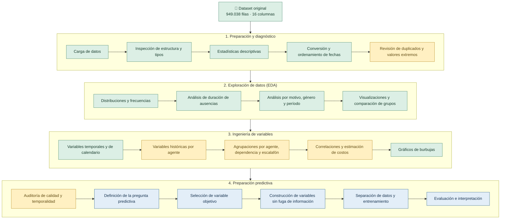
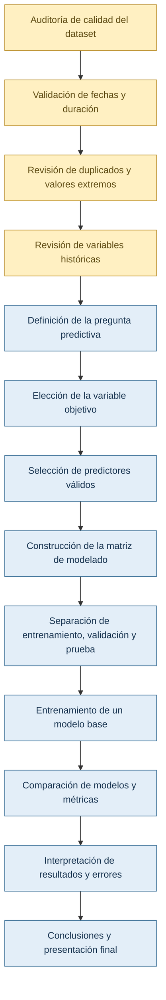

# Data Science Project: Análisis y Predicción de Ausentismo en la Administración Pública

Este repositorio contiene un proyecto end-to-end de Ciencia de Datos orientado al **Análisis Exploratorio (EDA)** y la **Modelación Predictiva del Ausentismo Laboral** en el ámbito de la administración pública. 

A través del procesamiento y la ingeniería de características (*Feature Engineering*) sobre registros masivos de licencias, el proyecto busca identificar patrones clave de ausentismo y entrenar modelos capaces de estimar el volumen, riesgo y duración de las inasistencias.

---

## Equipo de trabajo Nro 15
<ul>
  <li style="color: #81c6d2;"><b>Fabiana Winterstetter</b></li>
  <li style="color: #81c6d2;"><b>Nicolás Germán Diaz</b></li>
  <li style="color: #81c6d2;"><b>Nadir Nahuel Quiroga</b></li>
   
</ul>

---

## 📋 Tabla de Contenidos

- [Descripción del Dataset](#-descripción-del-dataset)
- [Objetivos del Proyecto](#-objetivos-del-proyecto)
- [Ingeniería de Variables (Feature Engineering)](#-ingeniería-de-variables-feature-engineering)
- [Modelos Predictivos Propuestos](#-modelos-predictivos-propuestos)
- [Flujo de trabajo realizado y planificado](#-flujo-de-trabajo-realizado-y-planificado)

---

## 📊 Descripción del Dataset

El conjunto de datos (`prueba2025_b.csv`) contiene **949,038 registros históricos** de licencias y ausencias de agentes públicos con 16 variables originales sin valores nulos:

| Variable | Descripción |
| :--- | :--- |
| `Nro legajo` | Identificador único del agente/empleado. |
| `Escalafon` | Agrupamiento o carrera dentro de la administración pública. |
| `Categoría` | Categoría o clase dentro del escalafón de la administración pública. |
| `Cod Art ausencia` | Código del artículo de la licencia según la normativa laboral. |
| `Descripcion articulo ausencia` | Detalle o motivo de la ausencia (ej. *Enfermedad Común*, *Razones Particulares*). |
| `Es de Salud?` | Flag categórico (`yes` / `no`) para licencias de índole médica. |
| `Fecha Desde` / `Fecha Hasta` | Periodo de inicio y fin de la licencia tomada. |
| `Cantidad dias` | Días corridos de duración de la ausencia. |
| `Cant Dias Permitido Mes/Año` | Límites normativos de días permitidos por periodo. |
| `Dependencia` | Oficina o área de trabajo del agente. |
| `Año Nacimiento` / `Genero` | Datos demográficos del agente. |
| `Género (Sexo)` |  |
| `Antigüedad` | Años de servicio prestados por el agente. |
| `Remuneración Mensual` | Sueldo que percibe el agente mensualmente. |

---

## 🎯 Objetivos del Proyecto

1. **Análisis Exploratorio de Datos (EDA):** Identificar la estacionalidad, los artículos de licencia más solicitados y las métricas de ausentismo según rango etario, género, antigüedad y dependencia.
2. **Feature Engineering Temporal y Acumulado:** Derivar variables continuas y categóricas a partir de los datos históricos de cada legajo.
3. **Predicción de Riesgo de Alto Ausentismo (Clasificación):** Identificar agentes con alta probabilidad de superar el umbral crítico de inasistencias en el año.
4. **Estimación de Duración de Licencias (Regresión):** Predecir la cantidad de días que abarcará una licencia médica o personal para mejorar la planificación operativa y cobertura de servicios.

---

## 💡 Ingeniería de Variables (Feature Engineering)

El pipeline de preparación transforma el dataset original agregando las siguientes dimensiones de análisis:

* **Variables Temporales y Estacionales:**
  * `Edad_Agente`: Edad calculada al momento del evento.
  * `Mes_Inicio` y `Trimestre`: Estacionalidad anual (picos invernales / fin de año).
  * `Es_Fin_De_Semana_Adyacente`: Indicador de inicio en día Lunes/Viernes ("efecto puente").
* **Variables Históricas Acumuladas por Agente:**
  * `Dias_Desde_Ultima_Ausencia`: Intervalo de días desde la última inasistencia registrada.
  * `Num_Licencias_Previas_Agente`: Recuento de licencias acumuladas en el histórico.
  * `Dias_Ausencia_Acumulados_Año`: Acumulado de días ausentes consumidos a la fecha.
  * `Tasa_Uso_Cupo_Anual`: Porcentaje del cupo normativo anual consumido.
* **Agregaciones Organizacionales:**
  * `Promedio_Dias_Dependencia`: Promedio de inasistencias por área de trabajo.
  * `Promedio_Dias_Escalafon`: Promedio de días ausentes según escalafón laboral.

---

## 🤖 Modelos Predictivos Propuestos

1. **Supervised Classification (Alto Riesgo de Ausentismo):**
   * *Algoritmos:* XGBoost, LightGBM, Random Forest.
   * *Métricas:* ROC-AUC, F1-Score, Precision-Recall Curve.
2. **Regression Models (Duración del Ausentismo):**
   * *Algoritmos:* LightGBM Regressor, CatBoost, Ridge Regression.
   * *Métricas:* RMSE, MAE, $R^2$.

---

## Flujo de trabajo realizado y planificado

**Referencia de colores:**

- 🟢 **Verde:** tareas realizadas o documentadas.
- 🟡 **Amarillo:** tareas que requieren revisión o validación.
- 🔵 **Azul:** próximos pasos del proyecto.

> Los colores representan el estado general de las actividades según el material revisado. Algunas tareas realizadas necesitan validaciones adicionales antes de utilizarlas en un modelo predictivo.

---

## Estado de las etapas realizadas

| N.º | Etapa | Estado | Comentarios |
|---|---|---|---|
| 1 | Carga del dataset | Realizado | Se dispone de 949.038 filas y 16 columnas. |
| 2 | Diagnóstico inicial | Realizado | Se revisaron estructura, tipos de datos y estadísticas descriptivas. |
| 3 | Preparación de fechas | Realizado | Se trabajó con la conversión y el ordenamiento de las fechas. |
| 4 | Análisis exploratorio (EDA) | Realizado | Se estudiaron distribuciones, frecuencias, duración y patrones del ausentismo. |
| 5 | Visualizaciones | Realizado | Se elaboraron gráficos para comprender el comportamiento de distintas variables. |
| 6 | Variables temporales | Realizado | Se generaron variables derivadas de fechas y calendario. |
| 7 | Variables históricas | Requiere revisión | Se deben verificar los cálculos acumulados y la disponibilidad temporal de la información. |
| 8 | Agrupaciones y comparaciones | Realizado / revisar | Se analizaron agentes, dependencias y escalafones; deben revisarse las definiciones de cada indicador. |
| 9 | Correlaciones y costos | Realizado / revisar | Los resultados son exploratorios y dependen de los supuestos utilizados. |
| 10 | Gráficos de burbujas | Realizado | Permiten comparar características de dependencias y escalafones. |
| 11 | Auditoría para Machine Learning | Pendiente de completar | Se debe validar la calidad de los datos y descartar fugas de información antes de entrenar modelos. |

---

## Comentarios sobre los resultados del análisis

### Distribución de la duración de las ausencias

Según las estadísticas descriptivas revisadas:

- **Cantidad de registros:** 949.038.
- **Duración media:** aproximadamente 4,28 días.
- **Mediana:** 1 día.
- **Percentil 75:** 3 días.
- **Duración máxima registrada:** 1.357 días.
- **Filas duplicadas detectadas:** 2.211, aproximadamente el 0,23 % del total.

La diferencia entre la media y la mediana indica que la distribución de la duración está sesgada hacia valores altos. La mayoría de los registros corresponde a duraciones cortas, mientras que algunos registros presentan duraciones muy prolongadas.

**Comentario:** los valores extremos deben investigarse antes de decidir si se conservan, corrigen o excluyen. No deben eliminarse automáticamente, porque podrían representar situaciones administrativas válidas.

### Variables temporales

Se generaron variables derivadas de las fechas, como:

- Edad aproximada del agente.
- Mes de inicio de la ausencia.
- Trimestre.
- Día de la semana.
- Indicadores asociados a fines de semana, feriados o días puente.

### 3.3. Variables históricas

El análisis contempla variables relacionadas con el historial de ausencias de cada agente, entre ellas:

- Cantidad de ausencias anteriores.
- Días de ausencia acumulados.
- Tiempo transcurrido desde una ausencia previa.
- Uso de días permitidos, cuando corresponda.

**Comentario:** estas variables necesitan una revisión temporal específica. Los cálculos deben utilizar solamente registros anteriores al evento que se desea predecir. Además, si un acumulado representa días consumidos durante un año, debe verificarse que se reinicie al cambiar el año y que no incluya información futura.

### Agrupaciones y gráficos de burbujas

Se realizaron comparaciones por dependencia y escalafón utilizando indicadores como:

- Antigüedad promedio.
- Duración promedio de las ausencias.
- Cantidad de registros.
- Distribución por género e índice de género.

**Comentario:** los gráficos permiten identificar diferencias entre grupos, pero no demuestran causalidad. Tampoco permiten estimar directamente una tasa de ausentismo de la dotación laboral si no se dispone de información sobre la cantidad de trabajadores que integran cada grupo.

---

## Controles pendientes antes del modelado

Antes de construir un modelo de Machine Learning, se recomienda completar los siguientes controles.

| Control | Qué revisar | Motivo |
|---|---|---|
| Consistencia de fechas | Comparar fecha de inicio, fecha de finalización y cantidad de días. | Detectar registros inconsistentes sin asumir que todas las reglas administrativas son iguales. |
| Fechas futuras | Investigar fechas posteriores a la fecha de análisis. | Determinar si son licencias programadas, proyecciones o errores. |
| Duraciones extremas | Inspeccionar los registros con mayor cantidad de días. | Identificar errores potenciales y casos excepcionales válidos. |
| Duplicados | Examinar las 2.211 filas detectadas. | Definir si son duplicados reales o registros repetidos legítimamente. |
| Variables históricas | Revisar agrupaciones, acumulados y orden temporal. | Evitar que el historial incluya datos posteriores al evento objetivo. |
| Remuneraciones negativas | Investigar los importes negativos. | Determinar si representan ajustes, particularidades administrativas o errores. |
| Fuga de información | Revisar todos los predictores y su fecha de disponibilidad. | Evitar modelos que utilicen información que no existiría al momento de predecir. |

## Esquema visual de los próximos pasos

### Descripción de los próximos pasos

| N.º | Paso | Objetivo |
|---|---|---|
| 1 | Auditoría de calidad | Revisar fechas, duración, duplicados y valores extremos. |
| 2 | Definir la pregunta predictiva | Establecer qué fenómeno se desea anticipar y para qué propósito. |
| 3 | Definir la variable objetivo | Determinar qué variable representará el resultado que se quiere predecir. |
| 4 | Seleccionar predictores | Elegir variables disponibles en el momento real de la predicción. |
| 5 | Construir la matriz de modelado | Preparar los datos de entrada y la variable objetivo. |
| 6 | Separar los datos | Crear conjuntos de entrenamiento, validación y prueba con una estrategia adecuada al uso previsto. |
| 7 | Entrenar un modelo base | Obtener una primera referencia de rendimiento. |
| 8 | Comparar modelos | Evaluar alternativas con métricas adecuadas al problema. |
| 9 | Interpretar resultados | Analizar errores, limitaciones y utilidad práctica. |
| 10 | Presentar conclusiones | Documentar metodología, resultados y posibles aplicaciones. |

